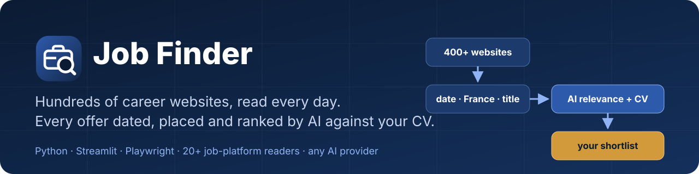
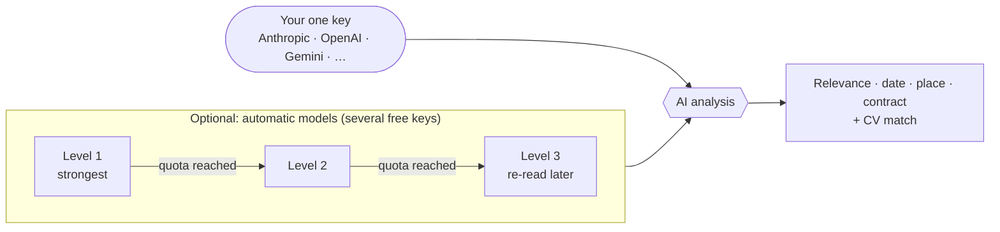
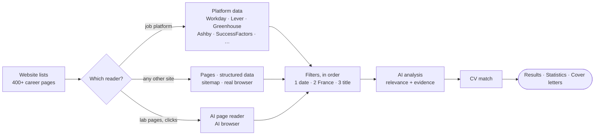
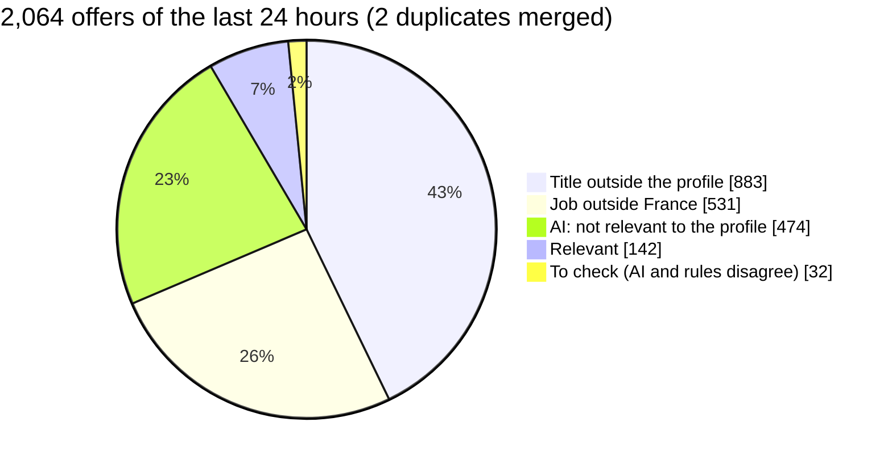
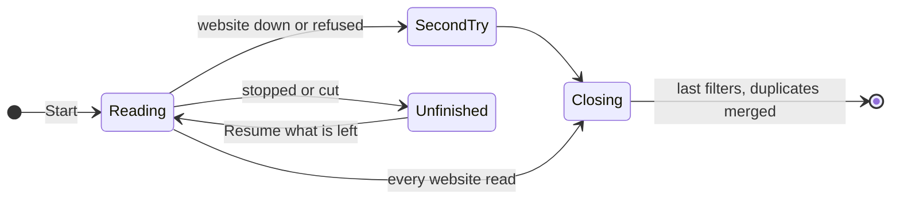

<p align="center">
  
</p>

<p align="center">
  <b>Stop refreshing 400 career pages. Job Finder reads them for you, every day,<br>and hands you the offers that match your CV.</b>
</p>

<p align="center">
  
  
  
  
  
  
</p>

<p align="center">
  <a href="#-quick-start">Quick start</a> ·
  <a href="#-how-it-works">How it works</a> ·
  <a href="#-proof-it-finds-the-offers">Results</a> ·
  <a href="#-one-ai-key-is-enough">AI keys</a> ·
  <a href="docs/HOW-IT-WORKS.md">Full reference</a>
</p>

---

## ✨ Why Job Finder

Job boards miss offers, show them late, and drown the good ones in noise. The best research and engineering roles
are published first on the companies' **own** career sites: hundreds of different pages, platforms and formats.

**Job Finder reads those sites directly**, for the period you choose (from the last 24 hours to 30 days), and gives each
offer back with **evidence**: when it was published, where the job is, why it matches you, and how well it fits your CV.

| | |
|---|---|
| 🌐 **Reads the source** | 400+ career sites in the lists provided: big groups, labs, start-ups, banks, ESN. 20+ job platforms read through their own data (Workday, SuccessFactors, Greenhouse, Lever, Ashby, SmartRecruiters, iCIMS, Teamtailor, Workable, Softy…), any other site through its pages, its sitemap or a real browser. |
| 📅 **Dates you can trust** | A publication date is taken only from evidence: never a "refreshed", deadline or start date. An undated offer shows the first day it was seen online. |
| 📍 **France, really** | Places are checked against official communes, departments and regions; multi-city and remote offers open to France are kept. |
| 🧠 **AI that explains itself** | Each offer gets a relevance score, a reason, the quotes behind its date, place and contract, and a match score against your CVs. |
| 🛡️ **Built to finish** | Websites that fail get a second try, a stopped scan resumes where it stopped, and a slow server never blocks the others. |
| 📊 **Market insight** | Skills most asked for, skills missing from your CV, companies hiring, salaries stated, every 15 days. |
| ✉️ **Cover letters** | Drafts a French cover letter in LaTeX for any offer. |

## 🚀 Quick start

```bash
git clone https://github.com/2ineddine/scrape-Job-websites.git && cd scrape-Job-websites
python3 -m venv .venv && source .venv/bin/activate
pip install -r requirements.txt
playwright install chromium
streamlit run app.py            # opens http://localhost:8501
```

Then, in the app:

1. **Settings** → paste one AI key (see below) and describe what you are looking for.
2. **Search** → upload the website lists (`websites.html` … `websites9.html`, or your own), add your CV, pick a date range.
3. Press **Start**. Results arrive while the scan runs; the **Results** page sorts them by CV match.

<details>
<summary><b>Run it with Docker</b></summary>

```bash
docker build -t job-finder .
docker run -d -p 127.0.0.1:8501:8501 --env-file api_keys.txt -v job-finder-data:/app/data job-finder
```

The app has no login: keep it on `127.0.0.1`, or reach it through an SSH tunnel or a proxy with authentication.
</details>

## 🔑 One AI key is enough

You do **not** need a collection of keys. **One key from one provider runs the whole analysis**, for example an
**Anthropic** key:

1. Open **Settings**, choose **Anthropic** as the provider and paste your key (`sk-ant-…`), then **Save key**.
2. Click **Load the models** and pick a Claude model. Every offer is then analysed and matched with it.

The same goes for a single **OpenAI**, **Gemini**, **Groq**, **OpenRouter**, **Cohere** or **NVIDIA** key, or a local
**Ollama** model (free and private). Keys are kept in `api_keys.txt` next to `app.py` (git-ignored) or in environment
variables, never in the code.

Have several free keys? Switch on **automatic models**: Job Finder starts with the strongest model and moves on when a
quota is reached, so a scan never stops because one provider is busy.



## 🧭 How it works



- **Date first.** An offer older than your range is never opened, and never sent to the AI.
- **Each website's offers go to the AI as soon as it is read**, while the next websites are read.
- **Nothing is dropped silently.** Every excluded offer keeps its reason, in the *Excluded* view.

### Where the offers go — one real scan

Scan of 15 November 2026, "Last 24 hours": **405 websites read in 76 minutes**, 23,336 offers seen, **2,064 published
in the range**. What happened to those 2,064:



## ✅ Proof it finds the offers

On 17 November 2026 the app's scan was compared with an **independent reading** of the same websites: each job
platform's own public API, every list page loaded in a real browser, and Hellowork's search.

- **Job platforms: 203 of the 206 offers** published in France in the last 24 hours were found. The 3 others: 2 on a
  platform that was down during the scan, 1 published after its website was read.
- Every miss found on the other websites was traced to its cause and fixed, with a regression test:

| Website | Offers of the range found before → after |
|---|---|
| Hellowork search, "data science" | **9 → 134** (its "newest first" list is two lists one after the other) |
| Inserm (offers on its Softy board) | **13 → 152** offers read |
| Alteca (one role posted in several cities) | **9 → 14** |
| SNCF (offers listed by number in its sitemap) | missed → found |

## 🛡️ Reliability



- **Second try** for every website that failed, after the others; one website's error never stops the rest.
- **Resume** an unfinished scan: only the websites not read and the offers not analysed are done again.
- **Polite and resilient**: one request per second per server, Workday's servers paced as one, a "slow down" (HTTP 429)
  honoured for every website on that server, a server that stops answering left alone for 10 minutes.
- **Offers of the last 24 hours are kept** with their analysis: the next scan does not open or analyse them again,
  which saves time and AI quota.
- **252 automated tests** (`python -m pytest -q`), each bug found in real scans pinned by its own test.

## 🔒 Responsible use

- The app identifies itself, reads **at most one page per second per server**, and **never gets around an anti-bot
  page, a login or a captcha**: such a website is reported as blocked, with what to do instead.
- **Respect robots.txt** is a setting. Turn it on unless you have each website's permission to read the pages its
  robots.txt closes. Sites such as LinkedIn, Indeed or Apec are not read.
- CVs go to a hosted AI only after you tick the consent box. For confidential data, prefer a paid plan whose terms
  exclude training, or a local Ollama model.
- Text from websites is treated as untrusted; private network addresses are refused; LaTeX runs without shell escape.

## 🗂️ Project layout

```
app.py              Streamlit app: Search, Results, Statistics, AI quota, Settings
jobfinder/
  scan.py           the scan: readers in parallel, filters, second try, resume
  crawler.py        generic reader: pages, sitemaps, browser rendering, Hellowork
  adapters.py       20+ job-platform readers and platform detection
  browser.py        AI browser and AI page reader
  analysis.py       AI analysis pipeline and CV matching
  llm.py            one interface to every AI provider, automatic model switching
  dates.py          publication dates from evidence
  classify.py       France check, title rules, offer types
  store.py          SQLite storage, kept offers, scan record
tests/              252 tests
docs/HOW-IT-WORKS.md   every rule in detail
websites*.html      the career-site lists
```

## 🗺️ Roadmap

- [ ] "Since my last scan" date range, so nothing published over a weekend is missed
- [ ] Company name read from more job-board cards
- [ ] Login for team deployments
- [ ] More job-platform readers

## 🤝 Contributing

Issues and pull requests are welcome: a career site the app reads badly, a job platform to add, a rule to improve.
Please add a test with the fix (`tests/`), and run `python -m pytest -q` before opening the pull request.

## 📄 License

[Apache 2.0](LICENSE).

---

<p align="center">If Job Finder saves you hours of refreshing career pages, <b>give it a ⭐</b> so others find it too.</p>
